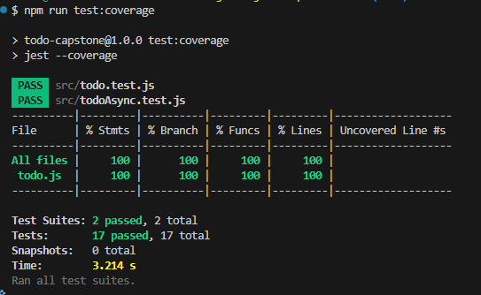

# Todo-модуль с полным покрытием тестами

Учебный проект: модуль управления задачами, разработанный по методологии **TDD**
и покрытый unit-тестами на **Jest 30**.

## Что внутри

- Чистые функции работы с задачами (создание, переключение, поиск, подсчёт).
- Асинхронная загрузка задач с изоляцией сети через моки.
- Автосохранение по таймеру.
- Полное покрытие тестами с порогом в конфигурации.
- Автоматический прогон тестов в CI (GitHub Actions).

## Технологии

Jest 30, Babel, ES-модули, GitHub Actions.

## Запуск

```bash
npm install
npm test              # прогнать тесты
npm run test:coverage # тесты + отчёт о покрытии
```

## Применённые техники тестирования

- Матчеры значений и ошибок (`toEqual`, `toThrow`)
- Параметризованные тесты (`test.each`)
- Проверка иммутабельности
- Моки зависимостей (`jest.fn`, `toHaveBeenCalledWith`)
- Асинхронные тесты (`async/await`, `resolves`, `rejects`)
- Виртуальное время (`useFakeTimers`, `advanceTimersByTime`)
- Снимки (`toMatchSnapshot`)
- Порог покрытия (`coverageThreshold`)

## Покрытие



---

_Разработано в рамках курса «Основы автоматизированного тестирования на Jest»._
